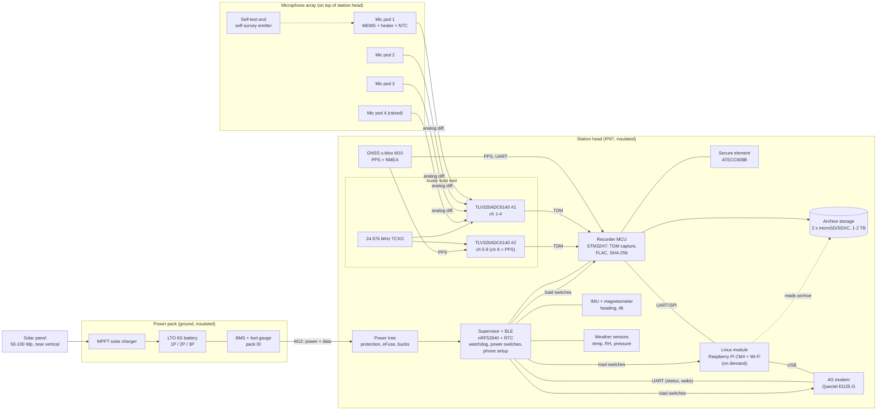

# Recording station hardware

Status: draft for review (step 1 of the plan). Owner: walto (hardware build), Claude (design support and firmware). Last updated 2026-11-02 (rev. 4: design-to-cost series parts list (section 9.4) and build from pre-made parts (section 12); rev. 3: individual-bird localisation and phone setup in v1 scope; winter battery split into two packs; v1 winter scope is southern and central Finland; build plan for a 3D printer plus assembly services).

This document proposes the hardware for one recording station and for kits of 1 to N stations. It traces choices back to `docs/requirements.md` (`REQ-…`). Numbers marked *(est.)* are engineering estimates that the prototype must measure. Numbers marked *(verify)* come from datasheets or vendor pages and need checking against the exact part revision before the design is frozen.

---

## 1. Summary of the proposal

- **One station = three modules:** a *station head* (electronics box with the microphone array on top), a *power pack* (battery and solar charger in its own insulated box at ground level), and a *solar panel*. Every station is self-contained with its own 4G and GNSS, so a kit scales from 1 to 20+ stations by adding identical stations (REQ-O5). No hub is needed.
- **Microphones:** 4 analog MEMS microphones in a tetrahedral array (about 40 cm across), each in a heated, downward-facing, membrane-protected pod. The ADC side has 8 channels, so a 6-mic variant fits the same board.
- **Sampling and timing:** two TI TLV320ADC6140 ADCs share one TCXO clock (all channels sample-locked, REQ-T2). The GNSS PPS pulse is recorded as its own audio channel, so every file carries sample-exact UTC markers (REQ-T1) and stations line up to well under 1 ms (REQ-T2).
- **Compute, two-tier:** a low-power real-time recorder MCU (STM32H7 class) records, FLAC-encodes and hashes audio around the clock. A Linux module (Raspberry Pi CM4) wakes only for bulk uploads and remote sessions. This is what makes 28 days of continuous recording in winter possible (REQ-O1). A Linux-only design is simpler but needs about 2.5 times the battery.
- **Power:** lithium titanate (LTO) cells, which charge and discharge down to about -30 to -40 °C without heating. A 6S2P LTO pack (about 1.1 kWh), delivered as two identical 9 kg packs, covers 28 days in midwinter in southern and central Finland with no solar at all. A 100 Wp panel mounted near vertical extends deployments from February to October indefinitely. A lighter LiFePO4 pack is offered for the warm season.
- **Locating individual birds (version 1 scope):** stations are sample-synchronised by GNSS, and each array gives a direction to every call. Calls heard by several stations can be located on a map and simultaneous callers counted. This needs station positions to about 10 cm and array headings to about 1 to 2°. A shared survey GNSS receiver in each kit gives the positions, and an **acoustic self-survey** (stations chirp to each other) checks positions and headings. Section 4.4 covers this.
- **Phone setup:** a Bluetooth Low Energy chip (which is also the supervisor MCU) lets a phone app set up and check a station. The Linux module adds Wi-Fi on demand for live listening and fast file download (section 6.5).
- **Integrity:** a secure element on the station signs the hash-chained manifests (REQ-I1, REQ-I2).
- **Cost:** about €1,450 to €2,650 per station at prototype quantities *(est.)*. The series version (section 9.4) comes to about **€740 to 1,110 per station with LTO, or €630 to 990 with sodium-ion cells**, against a target of €700 to 900. The target is reachable if sodium-ion passes the cold test, and only at the low end of the estimates with LTO. **With pre-made parts only (walto's choice for now) it is about €170 to 300 per station higher, so the target needs one custom board before series sales (section 12.2).**

The biggest open issue is **how much audio goes over 4G** (section 6.4). Uploading the full 4-channel archive in winter costs more energy and data than the station can afford, so this design treats the on-station disk as the archive of record and uploads signed manifests plus a reduced stream. This needs agreement with the Requirements, Edge and Cloud threads.

---

## 2. Block diagram



Text version for quick reading:

```
 [4-6 mic pods] --analog--> [2x ADC6140, TCXO] --TDM--> [Recorder MCU] --> [SD archive]
        ^                          ^ PPS on ch 8           |  SHA-256, signed by [Secure element]
 [self-test emitter]          [GNSS M10] --PPS/UART-------+
                                                           | UART
 [Supervisor nRF52840 BLE + RTC] --load switches--> [CM4 Linux, Wi-Fi] --USB--> [4G modem] --> cloud
   | sensors: battery V/I, temps, RH, IMU                           ^
   +--------------- status messages via modem AT/MQTT ---------------+
 [Power pack: LTO 6S + BMS + MPPT] <-- [solar panel]
```

---

## 3. Microphone array

### 3.1 Capsule choice

| Option | Self-noise / SNR | Cold rating | Unit-to-unit match | Notes |
|---|---|---|---|---|
| **Analog MEMS, Infineon IM73A135 (recommended)** | SNR about 73 dB(A) *(verify)* | -40 °C *(verify)* | tight (about ±1 dB) | Reflow-solderable, humidity-robust, high overload point (about 135 dB SPL). Analog output uses the ADC's low-noise inputs and avoids PDM clock lines in cables. |
| Digital PDM MEMS (e.g. Infineon IM69D130) | SNR about 69 dB(A) | -40 °C | tight | Simplest wiring, but the PDM clock on cables to the pods is an EMC risk and SNR is lower. Good for a cheaper "Lite" variant. |
| Analog electret (e.g. PUI AOM-5024L-HD) | SNR about 80 dB(A) | varies by part | wider spread, temperature drift | Lowest noise, so longer detection range, but needs per-unit calibration and is less consistent in cold and humidity. Worth testing side by side in the prototype. |

MEMS is the default because a trusted counting product benefits more from matched, stable, cold-rated channels than from the last few dB of noise floor. Electret capsules stay on the test list in case detection range is not good enough.

### 3.2 Array geometry

- **Tetrahedral, 4 mics:** three mics on horizontal arms 120° apart at a radius of about 20 cm, the fourth on a centre post about 25 cm higher. This gives azimuth and elevation with no front/back ambiguity, using time differences of arrival (for example GCC-PHAT) on broadband bird calls.
- Maximum time difference is about 1 ms across the array. With 48 kHz sampling and sub-sample interpolation, direction resolution of a few degrees is realistic *(est.)*. Spatial aliasing matters less for broadband calls with GCC-PHAT than for beamforming.
- A 6-mic variant (adding two mics at different heights) improves robustness when one pod fails or ices up. The ADC side supports it without board changes.
- The array head sits at 2 to 3 m height, which keeps it above deep snow in northern Finland (up to about 1 m) and away from ground reflections.

### 3.3 Mic pod (weather, snow and ice)

Each pod is a small sealed unit that plugs into the station head:

- Mic on a small round PCB, **sound port facing down**, under a drip cap so rain and snow cannot sit on it.
- **ePTFE acoustic membrane** (IP67 class) sealing the sound port, plus a replaceable open-cell hydrophobic foam windscreen. A fur cover is an accessory for windy sites.
- **Heater:** a thin-film or resistor heater of about 0.3 W per pod, with an NTC for the pod temperature. The supervisor turns it on only in icing conditions (air temperature between about -10 and +1 °C with RH above 95 %, or when the self-test shows a sensitivity drop). Rime ice and freezing fog are the main risks, not dry cold.
- Differential analog signal over about 1 m of shielded twisted pair with an **IP67 M8 4-pin connector** (signal +, signal -, mic bias, heater). Pods are field-swappable.
- The pod nose accepts a **½-inch calibrator adapter**, so a standard 94 dB / 1 kHz acoustic calibrator can be used before and after each deployment (REQ-A3).
- Housing in UV-stable ASA (3D printed for the prototype) or machined POM for production.

The membrane and windscreen change the frequency response, especially above 8 kHz. Every pod design must be measured in its final form against a reference mic, and the correction stored with the unit (REQ-A6).

### 3.4 Self-test and health

A small piezo emitter in the array hub plays a known chirp at scheduled times (for example daily at a quiet hour). Comparing each channel's response to its reference shows a dead channel, ice or water on a membrane, or sensitivity drift (REQ-A4). It also checks the inter-channel timing end to end (REQ-T2). The chirp is logged so the analysis can ignore it.

### 3.5 Audio spec proposal (for REQ-A6)

- Sample rate 48 kHz, 24 bit, fixed gain (REQ-A1, REQ-A2).
- Frequency response 100 Hz to 16 kHz, within ±3 dB after per-unit correction, from -30 to +35 °C.
- **The ADC's dynamic range enhancer (DRE) and any AGC must be disabled on the archive channels.** DRE is a form of automatic gain change, which REQ-A2 forbids.

---

## 4. Audio front end and timing

### 4.1 ADC

Two **TI TLV320ADC6140** ADCs give 8 channels on one TDM bus. Each has 4 analog inputs with programmable gain and mic bias, about 113 dB dynamic range without DRE, 9.2 mW per channel at 48 kHz, and is rated -40 to +125 °C ([TI product page](https://www.ti.com/product/TLV320ADC6140)). Both are clocked from one **24.576 MHz TCXO (±1 to 2 ppm, -40 °C rated)**, so all channels sample at the same instant. That meets REQ-T2's 0.1 ms inter-channel limit by a wide margin.

Channel plan: ch 1 to 6 for microphones (4 fitted by default), ch 7 spare (reference mic or line input for testing), **ch 8 for the GNSS PPS signal**.

### 4.2 GNSS time and position

- **u-blox MAX-M10S** (or similar M10 module): low power (tens of mW), PPS output with tens of ns accuracy *(verify)*, -40 °C rated. An active patch antenna sits on top of the head.
- **PPS recorded as audio:** the PPS pulse, attenuated, goes into ADC channel 8. Every second of every file has a marker on the exact sample where UTC seconds start. Software reads the UTC time of each marker from NMEA and can align files across stations to a sample (about 21 µs) with no reliance on operating-system timestamps. This meets REQ-T1 (under 10 ms to UTC) and REQ-T2 (under 1 ms between stations) by a large margin.
- The recorder MCU also captures PPS on a timer input as a backup and logs GNSS lock state. Without lock the TCXO drifts at most about 7 ms per hour *(est.)*, and that period is flagged as REQ-T1 requires.
- **Station position:** the M10 module's position (a few metres) is logged continuously to detect if a station is moved. It is not accurate enough for locating birds; section 4.4 covers survey-grade positions.

### 4.3 Orientation

Direction of arrival is only useful in map coordinates if the array's heading is known. The magnetometer alone is only good to a few degrees near a steel mast and the battery, so the acoustic self-survey in section 4.4 is the main heading reference and the magnetometer detects later changes. A 9-axis IMU (accelerometer + magnetometer) logs heading and tilt each hour, and also detects if the station is knocked over or moved (tamper alert). The deployment guide will also ask the user to point a marked arm north, as a cross-check against magnetic errors near the battery.

### 4.4 Locating and counting individual birds across stations

Version 1 must locate individual birds with several stations (requirements Level 3, REQ-T2). The hardware supports two complementary methods, and the analysis can combine them:

- **Time differences between stations:** stations sample-locked to UTC through PPS (about 21 µs, about 7 mm of sound path) give the time differences of one call reaching 3 or more stations, which fixes its position.
- **Directions from each array:** each 4-mic array gives a bearing (and elevation) to the call. Two or more bearings crossing give a position, and bearings also separate birds calling at the same time from different directions.

What limits accuracy is not timing but **knowing where each station is and which way it points**. A 30 cm position error is about 0.9 ms of sound travel, and a 2° heading error moves a bird 50 m away sideways by about 1.7 m. Targets proposed for the Requirements doc:

| Quantity | Target | How |
|---|---|---|
| Station array centre position | 10 cm horizontal, 20 cm height | survey GNSS (below) |
| Array heading | 1 to 2° | acoustic self-survey, magnetometer for change detection |
| Inter-station timing | under 50 µs | PPS on ADC channel 8 (already in design) |
| Speed of sound | from measured air temperature | SHT45 at each station |

**Survey GNSS, one per kit:** a dual-band RTK receiver (u-blox ZED-F9P class with a survey antenna) that clamps onto each station's mast at setup and logs raw observations for about 30 to 60 minutes. Positions are post-processed against the National Land Survey of Finland's FinnRef reference stations (open data *(verify current access terms)*), or computed live with an RTK correction service, giving centimetre-level positions. One shared unit is cheaper than a dual-band receiver in every station and works the same way.

**Acoustic self-survey:** the emitter in each array is a small horn tweeter loud enough (about 100 dB SPL at 1 m *(est.)*) to be heard at neighbouring stations 50 to 150 m away. After setup, and then daily, each station plays a coded chirp in turn at a known GNSS time. The others record it, which gives:
- the time of flight between every pair of stations, so distances to a few cm, which cross-check the GNSS survey;
- the bearing of each neighbour at each array, so every array's heading to well under a degree *(est.)*;
- a check that every microphone and the timing chain work end to end (REQ-A4, REQ-T2).

The chirp is short, at a fixed time, and logged so analysis can remove it. Its sound level and timing must be checked against disturbance rules for sensitive sites (Requirements thread).

**Station spacing:** a station hears small songbirds out to roughly 50 to 150 m depending on species, wind and terrain *(est.)*. For localisation each bird should be heard by at least 2 arrays, and preferably 3 or more, so a localisation layout is a grid or triangle of **at least 3 to 4 stations about 50 to 100 m apart**. Larger species and open landscapes allow wider spacing. The deployment guide and phone app will suggest a layout from the area to cover.

**Four or six mics:** four mics are the minimum for 3D bearings without ambiguity. Six give better separation of simultaneous callers and tolerate one iced or failed pod. The ADC board supports six without changes, so the prototype will compare both before the product is fixed.

---

## 5. Compute, storage and integrity

### 5.1 Architecture options

| | **A. Linux only** | **B. Recorder MCU + Linux on demand (recommended)** |
|---|---|---|
| Recording | CM4 records, encodes and hashes 24/7 | STM32H7 records, encodes and hashes 24/7 |
| Linux module | always on | off most of the time, wakes for uploads and remote sessions |
| Average power, winter *(est.)* | about 2.2 W | about 0.9 W |
| Battery for 28 days at -30 °C, no sun | 6S4P LTO, about 2.2 kWh, about 32 kg | 6S2P LTO, about 1.1 kWh, 14 to 16 kg |
| Firmware effort | lowest: all Linux, Python/C | higher: bare-metal or RTOS recorder firmware plus Linux side |
| Failure modes | SD/eMMC corruption on power loss, Linux crash stops recording | recorder is simple and keeps going if Linux or modem fails |
| Cold | CM4 rated -20 °C, so a pre-heater or an industrial module is needed | MCU rated -40 °C; CM4 only boots after a short pre-heat |

**Recommendation:** build **prototype v0 as architecture A** on development boards (fastest way to get real audio, measure power and develop the analysis pipeline), then build the **product as architecture B**. The recorder MCU is a small, testable piece of firmware. It is the only realistic way to meet REQ-O1 in winter with a pack one person can carry.

### 5.2 Parts

- **Recorder MCU:** STM32H7 class with SAI (TDM input), SDMMC, and ideally a hardware hash unit (for example STM32H733/H735, which include crypto/hash *(verify)*). It records the TDM stream, writes FLAC files (one file per 10 to 60 minutes), computes SHA-256 when each file closes (REQ-I1) and has the secure element sign the chained manifest (REQ-I2). FLAC encoding of 4 to 8 channels at 48 kHz in real time on an H7 must be confirmed on the bench.
- **Linux module:** Raspberry Pi CM4 (2 GB RAM, 8 GB eMMC, with Wi-Fi/Bluetooth for local access, section 6.5), rated -20 to +85 °C. It runs the uploader, the VPN for remote access, and any heavier jobs. If cold tests show problems, swap for an industrial -40 °C module (for example i.MX8M Mini SoMs from Toradex or Variscite) on the same carrier footprint concept.
- **Supervisor MCU with Bluetooth:** Nordic nRF52840 module (BLE 5, -40 to +85 °C, microamp sleep) with an external low-power RTC (RV-3028, -40 °C). It is always on at a few mW and also handles phone setup (section 6.5). It runs the hardware watchdog, power-cycles the recorder, Linux module and modem, reads battery voltage/current/energy (TI INA228), temperatures (board, battery, pods, ambient) and humidity in the box, controls heaters, and sends the hourly status message (REQ-O3) through the modem's built-in TCP/MQTT stack without waking Linux.
- **Secure element:** Microchip ATECC608B (or NXP SE050). Holds the device private key used to sign manifests (REQ-I2) and to authenticate to the cloud.

### 5.3 Storage

Data volume for continuous recording at 48 kHz, 24 bit *(est.; outdoor audio with a 24-bit noise floor compresses to about 65 to 75 % in FLAC)*:

| Channels | Raw per day | FLAC per day | FLAC for 28 days |
|---|---|---|---|
| 4 | 50 GB | about 35 GB | about 1.0 TB |
| 6 | 75 GB | about 52 GB | about 1.5 TB |
| 1 (reduced stream) | 12 GB | about 8 GB | about 230 GB |

Proposal: **two industrial or high-endurance microSD/SDXC slots, 1 TB each**, written alternately, so one card failing loses at most half the files and the station keeps recording (REQ-O1: no silent data loss). Cards are swapped at each service visit. Availability of 1 TB cards rated to -25/-40 °C must be checked; the fallback is more slots with 512 GB cards. Architecture A would use an M.2 2242 NVMe SSD on the CM4's PCIe instead.

---

## 6. 4G and remote access

### 6.1 Modem

**Quectel EG25-G** (LTE Cat 4, global bands, falls back cleanly as Finland's 2G/3G networks close). Rated -35 to +75 °C operating and -40 to +85 °C extended, sleep about 1.8 mA and idle about 22 mA at 3.8 V ([Quectel spec](https://enpanel.quectel.com/wp-content/uploads/2021/03/Quectel_EG25-G_LTE_Standard_Specification_V1.6-1.pdf)). Cat 4 uplink (up to about 50 Mbps) matters because the station may need to move many GB. A Cat 1bis module is cheaper and lower power but too slow for audio uploads.

### 6.2 SIM and antennas

- Industrial SIM (MFF2 solder-down eSIM or industrial nano-SIM rated -40 °C), multi-operator if possible (Elisa, Telia, DNA coverage differs in remote areas).
- Two external LTE antennas (MIMO) on the mast with a surge arrester. A directional panel antenna is a kit accessory for weak-signal sites.

### 6.3 Remote access

- **Always available:** hourly status and alarms via the supervisor (REQ-O3), and remote configuration commands that the supervisor queues and logs (REQ-O4).
- **On demand:** the cloud sends a wake request (SMS or a message on the modem's open connection). The modem's ring-indicator line wakes the supervisor, which pre-heats if needed and boots the Linux module in about 30 to 60 s for a VPN session or a bulk upload.

### 6.4 Upload budget (open issue)

Locating birds across stations needs short multichannel clips from several stations around the same call. The "clips on request" path below covers this: the cloud asks every station in the layout for the same time window.


Uploading costs roughly 0.4 to 0.6 Wh per GB at good signal *(est.: modem about 2 W while sending at about 10 Mbps)*, and much more at weak signal. The full 4-channel archive is about 35 GB per day, which means about 3.2 Mbps sustained, about 16 Wh per day extra (doubling the winter battery), and about 1 TB of mobile data per station per month. In many remote Finnish sites the uplink cannot sustain that at all.

Proposed upload policy, configurable per project:

1. **Always:** signed manifests and hashes of every file, status, health and self-test results (kilobytes per hour). The cloud therefore knows exactly which files exist, and any later-ingested file can be verified against the chain (REQ-I2, REQ-I3).
2. **Default:** one reference channel in FLAC (about 8 GB per day) for cloud species ID, plus short multichannel clips on request.
3. **When power and coverage allow** (summer with solar, or a mains-powered site): the full multichannel archive.
4. **At service visit:** the SD cards are the archive of record and are ingested and verified against the signed manifests. The station only deletes files after the cloud confirms their hashes (REQ-I3), so nothing is lost by uploading less.

This keeps REQ-I1 to REQ-I4 intact, but it changes what "upload" means in REQ-I3 and REQ-O2. The Requirements, Edge and Cloud threads should agree on it.

### 6.5 Phone setup over Bluetooth and Wi-Fi

- **Bluetooth Low Energy (always available):** the supervisor nRF52840 advertises for about 10 minutes after power-up or after the user taps a magnet on a marked spot on the box (a reed switch, so there is no hole or button to leak). The phone app can then pair, set station name and project, show GNSS lock, battery, live microphone levels and the self-test result, start the survey and self-survey, and set the schedule and gain. Pairing uses a per-station code on the QR label, and every configuration change is logged with time and user (REQ-O4).
- **Wi-Fi (on demand):** from the app the user can wake the Linux module, which opens a local Wi-Fi access point for live listening, viewing recent recordings and fast download of clips. It turns off again when the session ends.
- Polycarbonate is radio-transparent, so the Bluetooth and Wi-Fi antennas stay inside the box. Power cost is negligible because both radios are only on during setup visits.

---

## 7. Power

### 7.1 Why lithium titanate (LTO)

The station's own heat cannot keep a battery warm. A well-insulated box (50 mm XPS, about 0.5 m² surface) loses about 0.35 W per kelvin, so keeping a battery at 0 °C when it is -30 °C outside would need about 10 W continuously, ten times the station's whole budget *(est.)*. The battery chemistry itself must therefore work in the cold.

| Chemistry | Discharge at -30 °C | Charge below 0 °C | Energy density | Verdict |
|---|---|---|---|---|
| **LTO (lithium titanate)** | works, roughly 70 to 80 % of capacity at low current *(verify by test)* | yes, typically to -30 °C or lower | low, about 70 to 80 Wh/kg | **Recommended for year-round kits.** 10,000+ cycles, very safe. |
| LiFePO4 | poor; many cells spec -20 °C minimum | no; needs heating before charging | about 110 to 140 Wh/kg | **Warm-season pack** (April to October): lighter and cheaper. |
| Li-ion NMC | usable to about -20 °C | no | high | Not recommended: cold-charge and safety risks outdoors. |
| Lead-acid AGM | about 50 % | slow | about 30 Wh/kg | Too heavy (over 50 kg for the same usable energy). |
| Li-SOCl2 primary | excellent, to -55 °C | not rechargeable | very high | Only for an extreme-site option; expensive and creates waste. |

LTO cells such as the Yinlong 66160 (2.3 V, 40 Ah, about 92 Wh, about 1.1 to 1.3 kg per cell *(verify)*) are widely sold ([example vendor](https://hakadibattery.com/collections/lto-battery-cells-2-3v)). For a trusted product, cells should come from a traceable A-grade supplier (Yinlong/Gree, or Toshiba SCiB at higher cost), each pack tested for capacity before shipping.

A 6S LTO pack runs from about 10.8 to 16.2 V and a 4S LiFePO4 pack from about 10 to 14.6 V, so **one station input range of 9 to 17 V accepts both**. Each pack carries an ID chip, so the charger and the station know which chemistry and size are plugged in.

### 7.2 Power budget (architecture B, winter, continuous recording) *(est.)*

| Load | Average power |
|---|---|
| Recorder MCU (TDM capture, FLAC, SHA-256) | 0.25 W |
| SD card writes | 0.05 W |
| 2 ADCs, 4 mics, bias, TCXO | 0.08 W |
| GNSS (continuous for PPS) | 0.03 W |
| 4G modem: idle connected + reduced-stream upload (about 8 GB/day) | 0.20 W |
| Linux module, about 2 h/day at 1.5 W | 0.13 W |
| Supervisor, sensors, secure element | 0.02 W |
| Mic heaters (about 10 % of winter time, 4 pods) | 0.10 W |
| Converter losses (about 10 %) | 0.09 W |
| **Total** | **about 0.9 W (about 22 Wh/day)** |

Architecture A comes to about 2.2 W (53 Wh/day), mainly because the CM4 runs all the time (about 1.4 W) and needs an SSD.

### 7.3 Battery sizing

Usable winter energy = nominal × 0.75 (cold) × 0.9 (depth of discharge and ageing margin) *(est.)*.

| Pack (LTO 6S, 40 Ah cells) | Nominal | Usable at -30 °C | Weight (cells + box) | Days, arch. B (0.9 W) | Days, arch. A (2.2 W) |
|---|---|---|---|---|---|
| 6S1P (6 cells) | 552 Wh | about 370 Wh | about 9 kg | about 17 | about 7 |
| **6S2P (12 cells)** | 1,104 Wh | about 745 Wh | about 17 kg | **about 34** | about 14 |
| 6S3P (18 cells) | 1,656 Wh | about 1,120 Wh | about 25 kg | about 52 | about 21 |

So **architecture B with a 6S2P pack meets REQ-O1 (28 days, -30 °C) with no solar at all**, with about 20 % margin. The supervisor reports remaining runtime, and if the battery runs low it closes files cleanly, uploads a final manifest and stops with an alarm rather than corrupting data (REQ-O1: no silent loss).

**Making it lighter: two 9 kg packs instead of one 17 kg pack.** The station has two power inputs combined through ideal diodes, so the winter energy can come from **two identical 6S1P packs** (about 9 kg each) instead of one 6S2P pack. Each pack is a comfortable single carry, the same pack is used alone from February to October, and a kit needs only one pack design. The station draws from both and reports each pack's charge separately. The trade-off is one extra cable and connector per station and slightly more cost (about €60 to 100 for the second BMS and box).

Other ways to get below 17 kg, which the prototype will measure:
- **Lower upload volume.** Uploading the reference channel compressed (about 1 GB/day) instead of lossless (about 8 GB/day) saves about 3 Wh/day, roughly 13 % of the winter budget *(est.)*. Whether lossless upload is worth it is being compared in the Edge and Cloud docs; the hardware supports both.
- **Counting some December sun in southern Finland.** Even 10 Wh/day average from the panel would cut the battery needed for 28 days by about 40 %. This is not counted yet, because sunless weeks are common; field data from the pilot will show if a single 6S1P pack is enough in the south.
- **Lower measured power.** Every 0.1 W saved is about 67 Wh, or about 1 to 1.5 kg of LTO cells, over 28 days.

### 7.4 Solar

Rough yields for one 100 Wp panel facing south at about 70 to 90° tilt *(est.; verify per site with [PVGIS](https://re.jrc.ec.europa.eu/pvg_tools/en/), which this environment could not reach)*:

- **December, southern Finland:** about 10 to 40 Wh per day on average, with many days near zero. **Lapland in December to mid-January (polar night):** essentially zero.
- **February to March:** strong, often 150 to 300 Wh per day, helped by snow reflection on a near-vertical panel.
- **April to September:** far more than the station needs.

Design rule: **size the battery as if there is no sun from November to January.** Treat solar as a bonus then, and as the main source the rest of the year, when a 6S1P or LiFePO4 pack plus a 50 to 100 Wp panel runs indefinitely. A near-vertical panel sheds snow and catches the low winter sun.

**Version 1 winter scope is southern and central Finland.** Lapland during the polar night (no usable sun from about December to mid-January) is planned for a later version. It would need either three 6S1P packs per station or a higher-energy cold-rated option, and it is left out of the v1 sizing.

### 7.5 Charger, BMS and power tree

- **Prototype:** Victron SmartSolar MPPT 75/10 with user-defined voltages for LTO (operating range down to -30 °C *(verify)*, which is at the edge, so it goes inside the insulated pack box), and a commercial 6S LTO BMS with balancing.
- **Product:** an integrated power-pack PCB with an MPPT buck-boost controller rated -40 °C (for example ADI LT8491), a 6S protection and balancing IC that supports LTO thresholds (for example TI BQ76930 class *(verify cell UV range down to 1.8 V)*), a fuel gauge and the pack ID chip.
- **Station power tree:** reverse-polarity ideal diode, TVS and fuse, eFuse, then a high-efficiency 5 V buck for the Linux module, a dedicated 3.8 V buck for the modem (2 A peaks), a 3.3 V buck for digital, and low-noise LDOs for the ADC analog rails. All parts rated -40 °C. Each load sits behind a supervisor-controlled load switch.
- **Pack to station cable:** IP67 M12 connector with power plus a data line (pack ID, state of charge, pack temperature).

---

## 8. Enclosure, mounting and environment

- **Station head:** IP67 polycarbonate box (about 250 × 200 × 120 mm, Fibox or Spelsberg class), lined with 20 to 30 mm closed-cell foam to slow temperature swings, a Gore-type pressure-equalising vent and a desiccant pack against condensation. PCBs are conformal-coated. All cables enter through IP67 M8/M12 bulkhead connectors, so the user never opens the box in the field.
- **Array frame:** aluminium or carbon tube arms on a hub that bolts onto the box lid, folding for transport.
- **Weather sensors (REQ-A5):** Sensirion SHT45 (temperature, RH) in a small radiation shield and a Bosch BMP390 (pressure). Wind and rain are estimated from the audio first; a cheap rain sensor is optional.
- **Mounting:** tree strap or a 2 to 3 m pole/tripod with guy lines. The power pack sits on the ground, connected by a 3 to 5 m cable. A cable lock and the IMU tamper alarm deter theft.
- **Protection:** surge arresters on antenna lines, TVS on all external connectors.
- **Radio approval:** using a pre-certified modem module and GNSS receiver keeps CE/RED testing simpler. EMC and RED testing of the full station are still needed before sale (Product thread).

---

## 9. Parts list (one station, prototype quantities)

Prices in euros, excluding VAT, at 1 to 5 units *(est.)*. Small-series prices (50+) are expected to be roughly 40 to 55 % of these. Exact suppliers and part numbers go into a BOM spreadsheet in step 3.

### 9.1 Station head (architecture B)

| # | Item | Example part | Qty | Est. cost |
|---|---|---|---|---|
| 1 | MEMS microphone | Infineon IM73A135V01 | 4 (+2 spare) | €15 to 25 |
| 2 | Mic pod parts: PCB, housing, ePTFE membrane, foam, heater, NTC, M8 cable | custom | 4 | €80 to 140 |
| 3 | Audio ADC | TI TLV320ADC6140 | 2 | €10 to 16 |
| 4 | TCXO 24.576 MHz, ±2 ppm, -40 °C | various | 1 | €3 to 6 |
| 5 | Recorder MCU | STM32H733/H735 | 1 | €10 to 15 |
| 6 | Supervisor MCU with BLE + RTC + power monitor + reed switch | nRF52840 module, RV-3028, INA228 | 1 set | €18 to 28 |
| 7 | Secure element | Microchip ATECC608B | 1 | €1 to 2 |
| 8 | Archive storage, 1 TB high-endurance/industrial | microSDXC | 2 | €150 to 400 |
| 9 | Linux module with Wi-Fi/BT, internal antenna | Raspberry Pi CM4 2 GB / 8 GB eMMC, wireless | 1 | €55 to 80 |
| 10 | 4G modem | Quectel EG25-G | 1 | €40 to 60 |
| 11 | Industrial SIM / eSIM | operator | 1 | (opex) |
| 12 | GNSS module + active antenna | u-blox MAX-M10S | 1 | €25 to 40 |
| 13 | IMU + magnetometer | ST or Bosch 9-axis | 1 | €6 to 10 |
| 14 | Weather sensors + radiation shield | SHT45, BMP390 | 1 set | €20 to 30 |
| 15 | Self-test and self-survey emitter (horn tweeter) + amplifier | various | 1 | €15 to 30 |
| 16 | Carrier PCB, fab and assembly | custom, 4 to 6 layers | 1 | €150 to 300 |
| 17 | Power tree components | bucks, eFuse, TVS, ideal diode | 1 set | €20 to 35 |
| 18 | Enclosure, foam, vent, desiccant | Fibox/Spelsberg IP67 | 1 | €50 to 80 |
| 19 | IP67 bulkhead connectors and cables | M8/M12 | 7 | €50 to 80 |
| 20 | Array frame and hub | aluminium/carbon, printed hub | 1 | €30 to 60 |
| 21 | LTE antennas (2) + surge arrester | outdoor omni | 1 set | €40 to 80 |
| 22 | Mounting kit and cable lock | strap, pole clamp | 1 | €40 to 70 |
| 23 | Fasteners, coating, misc. | | | €20 to 30 |
| | **Station head total** | | | **about €850 to 1,630** |

### 9.2 Power pack and solar

| # | Item | Example part | Qty | Est. cost |
|---|---|---|---|---|
| 24 | LTO cell 2.3 V 40 Ah, A-grade | Yinlong 66160 | 12 (6S2P) | €300 to 540 |
| 25 | 6S LTO BMS with balancing | commercial for prototype | 1 | €40 to 90 |
| 26 | MPPT charger | Victron SmartSolar 75/10 | 1 | €70 to 90 |
| 27 | Pack ID / fuel gauge board | custom | 1 | €15 to 25 |
| 28 | Insulated IP65 pack box, connectors | | 1 | €60 to 100 |
| 29 | Solar panel 100 Wp mono + near-vertical bracket + cable | | 1 | €110 to 180 |
| | **Power pack (6S2P) + solar total** | | | **about €600 to 1,030** |

A 6S1P pack saves about €150 to 270 and 8 kg. Two 6S1P packs instead of one 6S2P add about €60 to 100. A warm-season LiFePO4 pack (12.8 V, 50 Ah) costs about €150 to 250.

### 9.3 Per kit (shared across stations)

| Item | Est. cost |
|---|---|
| Acoustic calibrator (94 dB, 1 kHz, class 1 or 2) with ½-inch pod adapter (REQ-A3) | €300 to 700 |
| Survey GNSS: dual-band RTK receiver (u-blox ZED-F9P class), survey antenna, mast clamp, battery (section 4.4) | €300 to 500 |
| Transport cases, spare pods, spare windscreens, tools | €150 to 300 |

**One complete station (head + 6S2P pack + panel): about €1,450 to 2,660 at prototype quantities** *(est.)*. Shared kit items add about €750 to 1,500 per kit, so a 4-station localisation kit comes to roughly €6,600 to 12,100 at prototype prices. Architecture A saves the recorder MCU (about €15) but needs an SSD and a 6S4P pack (about €300 to 550 more and about 15 kg heavier than 6S2P).

---

### 9.4 Design to cost: series version

Target from the business plan (PR #2, section 6): a 4-station localisation kit sells for about €9,000 to 12,000, so parts should be about **€700 to 900 per station** plus shared kit items. The quality claims stay fixed: 28 days of continuous recording at -30 °C, localisation accuracy (section 4.4), and signed data (REQ-I1, REQ-I2).

The prototype prices above are for 1 to 5 units. This list is for a series of about 50 to 100 stations, with the cost-down choices below. *(All est.; to be confirmed with supplier quotes in step 3.)*

**Cost-down choices that keep the quality claims:**

| Change | Saves per station *(est.)* | Effect on quality |
|---|---|---|
| Linux module: Raspberry Pi Zero 2 W (has Wi-Fi/BT) instead of CM4 | €35 to 55 | none for recording, since Linux only runs on demand; pre-heat before boot in deep cold |
| Europe-only LTE Cat 4 modem (Quectel EC25-E class) instead of the global EG25-G | €10 to 25 | none in Finland |
| One combined LTE + GNSS antenna puck instead of separate antennas | €20 to 40 | none |
| 50 Wp panel instead of 100 Wp | €30 to 50 | none: winter sizing ignores solar anyway, and 50 Wp covers the load from February to October |
| Own power-pack PCB (MPPT, BMS, fuel gauge) instead of Victron + commercial BMS | €60 to 100 | same function, rated -40 °C |
| Archive at 16 bit instead of 24 bit, 2 × 512 GB cards | €60 to 250 | none measurable: the mics' own noise (SNR about 73 dB) sits well above the 16-bit floor (96 dB) at a fixed, correctly set gain. REQ-A1 allows 16 bit |
| Fewer bulkhead connectors (one multi-pin connector for the array head) | €20 to 40 | none |
| Battery: **sodium-ion cells** instead of LTO, *if they pass the cold test* | €100 to 250 | must still give 28 days at -30 °C; also about 5 to 7 kg lighter per station |

Sodium-ion cells are now made in volume (CATL, HiNa and others). They are reported to keep most of their capacity well below -20 °C and cost less per Wh than LTO, with higher energy density *(verify cold charge and discharge limits per cell datasheet)*. They are the most promising way to cut both cost and weight. The prototype will test one sodium-ion pack against an LTO pack side by side, outdoors in January. LTO stays the fallback.

**Series parts list, one station:**

| Block | LTO version | Sodium-ion version |
|---|---|---|
| Mics and 4 pods (moulded or printed housings, membranes, heaters, cables) | €55 to 80 | €55 to 80 |
| Audio front end (2 ADCs, TCXO, LDOs) | €12 to 18 | €12 to 18 |
| Recorder MCU, BLE supervisor, RTC, power monitor, secure element | €20 to 30 | €20 to 30 |
| Archive storage, 2 × 512 GB | €60 to 100 | €60 to 100 |
| Linux module (Pi Zero 2 W) | €18 to 22 | €18 to 22 |
| 4G modem (EC25-E class) + industrial SIM holder | €25 to 35 | €25 to 35 |
| GNSS M10 module | €10 to 15 | €10 to 15 |
| IMU, weather sensors, self-survey emitter | €20 to 30 | €20 to 30 |
| Carrier PCB, fabricated and assembled | €40 to 70 | €40 to 70 |
| Power tree on carrier | €12 to 18 | €12 to 18 |
| Enclosure, insulation, vent, connectors | €45 to 70 | €45 to 70 |
| Array frame, combined antenna puck, mounting kit, misc. | €60 to 90 | €60 to 90 |
| **Station head subtotal** | **€377 to 578** | **€377 to 578** |
| Battery cells, about 1.1 kWh in two packs | €220 to 320 | €110 to 200 |
| Two pack PCBs (BMS, MPPT on one, fuel gauge, ID) and boxes | €90 to 140 | €90 to 140 |
| 50 Wp panel, near-vertical bracket, cables | €50 to 75 | €50 to 75 |
| **Power subtotal** | **€360 to 535** | **€250 to 415** |
| **Station total** | **€737 to 1,113** | **€627 to 993** |

**Shared kit items at series prices:** survey GNSS €250 to 400, calibrator €250 to 500, cases and spares €100 to 200, so about **€600 to 1,100 per kit**.

**4-station localisation kit, parts:** about **€3,550 to 5,550 with LTO**, or **€3,100 to 5,050 with sodium-ion**.

**Verdict:** the €700 to 900 per station target is **reachable with sodium-ion cells**, and **only at the low end of the estimates with LTO**. A realistic midpoint with LTO is about €900 to 950 per station, which is €50 to 250 over target. The decisive unknowns are cell prices at volume and whether sodium-ion meets the cold test. Neither can be settled before the prototype. Lower-quality options were not used: fewer mics, no heaters, a smaller winter battery, or no secure element would each break a quality claim. If the January cold test rules out sodium-ion, the kit price should be revisited, as the business plan already allows.

## 10. Trade-offs at a glance

| Decision | Chosen | Alternative | Why |
|---|---|---|---|
| Mic type | analog MEMS | electret, digital MEMS | matched, cold-rated, robust; electret tested in prototype for range |
| Mics per station | 4 (6 optional) | 2, 8 | 4 is the minimum for 3D direction without ambiguity |
| Timing | PPS recorded as an audio channel | GPS-disciplined oscillator, OS timestamps | sample-exact, simple, verifiable in the data itself |
| Compute | recorder MCU + Linux on demand | Linux only | 2.5 times less energy, recording survives Linux or modem faults |
| Archive | on-station SD, manifests uploaded | full upload over 4G | 4G energy and data cost; integrity preserved by signed manifests |
| Battery | LTO | LiFePO4, Li-SOCl2 | charges and discharges at -30 °C without heating |
| Layout | separate power pack at ground | all in one box | heavy pack on the ground, light head on the mast, pack sizes swappable |
| Kit scaling | identical autonomous stations | hub with mesh radio | each station works alone, so 1 to 20+ stations is just a count |
| Station positions | shared survey GNSS + acoustic self-survey | dual-band GNSS in every station, tape and compass | centimetre positions and sub-degree headings at lowest cost per station |
| Phone setup | BLE on the supervisor, Wi-Fi from Linux on demand | Wi-Fi only | BLE is always available at microwatts; Wi-Fi only when its bandwidth is needed |

---

## 11. Risks and how the prototype tests them

1. **Power is higher than estimated.** Measure each block on the bench (INA228 logging) in v0. The design has margin, and the upload policy is the main lever.
2. **LTO capacity at -30 °C.** Discharge-test a 6S1P pack in a freezer and outdoors in January at the real station current.
3. **Icing of mic membranes.** Freezer and outdoor tests with mist spray; check that the self-test detects it and the heater clears it.
4. **Membrane and windscreen frequency response** above 10 kHz. Measure against a reference mic.
5. **FLAC encoding throughput on the MCU.** Bench test early. Fallback: store uncompressed on larger cards, or a faster MCU (i.MX RT class).
6. **CM4 booting at -30 °C.** Cold-boot tests with and without the pre-heater. Fallback: industrial SoM.
7. **4G coverage at remote sites.** Log signal quality in the field pilot; directional antenna accessory.

Cold testing is planned in section 12.3.

---

## 12. Building from pre-made parts (walto's decision, 2026-11-02)

walto chose to build stations from **pre-made modules and boards**, not custom circuit boards. The architecture stays the same (section 5.1, architecture B). Each block becomes a ready-made board, wired together with connectors on a 3D-printed mounting plate. Only cables, connectors and a few through-hole joints need soldering.

### 12.1 Pre-made version of each block

| Block | Pre-made part *(example, verify availability)* | Note |
|---|---|---|
| Microphones | 4 to 6 digital PDM MEMS mic boards (Infineon IM69D130 "Shield2Go" class) in printed pods | Replaces the analog mic + ADC6140 chain, because no pre-made multichannel ADC board fits well. SNR about 69 dB instead of 73 dB (see 12.2). |
| Recorder MCU | STM32H7 board without debugger power drain (for example a WeAct or Nucleo-H723 class board) | Its SAI interface reads up to 8 PDM mics on one shared clock, so channels stay sample-locked. |
| Timing | u-blox MAX-M10S breakout (SparkFun class) with active antenna | PPS goes to a timer input on the recorder, which is clocked from the same source as the mic clock. That keeps sample-exact UTC timing without a spare audio channel. |
| Storage | 2 microSD breakout boards, high-endurance cards | |
| Supervisor + Bluetooth | nRF52840 board (Seeed XIAO or Adafruit Feather class) | |
| RTC, power monitor, secure element, IMU, weather | I2C breakouts (RV-3028, INA228, ATECC608B, 9-axis IMU, SHT45, BMP390) | Qwiic/STEMMA cables, no soldering. |
| Linux + Wi-Fi | Raspberry Pi Zero 2 W | Off except during uploads and setup. |
| 4G | Quectel EC25-E mini-PCIe card on a USB adapter board | |
| Power conversion and switching | Pre-made buck modules (Pololu class, -40 °C rated) and load-switch modules | |
| Self-survey emitter | small horn tweeter + class-D amplifier board | |
| Battery | Ready-made 12 V LTO packs (6S, about 40 Ah, with built-in BMS), or sodium-ion packs once available and tested | Two packs per station in winter, one in summer. |
| Solar charging | Victron SmartSolar MPPT 75/10 | Rated to -30 °C, which is the edge of the requirement; it sits inside the insulated pack box. |
| Enclosure, pods, frame | Bought IP67 box and connectors; pods, hub, plate and brackets 3D printed in ASA | |

### 12.2 Where pre-made parts make the targets hard

1. **Price (biggest effect).** Ready-made boards cost more than the same chips on one board, and the Victron charger costs more than its own circuit. The series estimate rises by about **€170 to 300 per station**, to about **€900 to 1,400 with LTO** or **€800 to 1,300 with sodium-ion**, against the €700 to 900 target *(est.)*. With pre-made parts **the price target is not reachable**. It is reachable with one custom carrier board (section 9.4), which can be designed and assembled by a service rather than by walto.
2. **Winter battery.** Dev boards carry power LEDs, extra regulators and USB chips that are always on. Even with LEDs removed, the station is expected to draw about **1.1 to 1.3 W instead of 0.9 W** *(est.)*. That needs about 25 to 45 % more battery for 28 days at -30 °C, so roughly **three 9 kg packs in midwinter instead of two**, unless the measured power comes out lower.
3. **Cold rating.** Many hobby boards use parts rated only to -20 °C or are not specified at all (the Pi Zero 2 W is rated -20 °C). Every board must pass the -30 °C outdoor test. Parts that fail are swapped for industrial modules, which cost more.
4. **Localisation.** Timing and array geometry are unaffected. The digital mics are about 4 dB noisier, which shortens detection range somewhat in quiet winter forests *(est.)*. PDM mic signals over 0.5 to 1 m cables need careful shielding, which the prototype must verify. Neither is expected to break the accuracy targets in section 4.4.
5. **Reliability and signed data.** Signing and hashing are unaffected (same secure element). Many connectors and jumper cables are a field-reliability risk from vibration, frost and moisture. Use locking connectors, secure cables in printed clamps, and conformal-coat the boards.

**Recommendation:** build v0, v1 and the pilot kit from pre-made parts, as walto wants. This is the fastest way to real data and costs nothing in quality for testing. Revisit one custom carrier board, designed and assembled by a service, before series sales, because it is what brings the price and winter battery back to target.

### 12.3 Prototype path (input for step 3)

- **v0, bench:** STM32H7 board + 4 PDM mic boards + GNSS breakout, recording to SD with PPS timing; Pi Zero 2 W + EC25-E for upload; INA228 logging power. Goal: real 4-channel recordings, measured power, data for the Edge and Cloud threads.
- **v1, field:** all blocks from table 12.1 on a printed plate in the IP67 box, printed mic pods, one ready-made LTO pack and Victron charger. Goal: 2-week outdoor test, then a 4-week January test with a sodium-ion pack beside an LTO pack.
- **v2, pilot kit:** 4 stations for the field pilot in step 4, still from pre-made parts.

**Cold testing without a chamber:** a chest freezer (about -18 to -25 °C) is enough for early tests of pods, icing and battery discharge. Real -30 °C tests can be done outdoors in central or northern Finland from December to February. A rented climate chamber is needed once, before sale, for a documented test *(verify availability and cost)*.

---

## 13. Open questions

For walto:

Answered 2026-11-02: version 1 must count and locate individual birds with multiple stations (section 4.4), power is solar plus battery (section 7), and stations include Bluetooth and Wi-Fi for phone setup (section 6.5).

Answered 2026-11-02 (second round): a 17 kg pack is acceptable but smaller is preferred (section 7.3 now offers two 9 kg packs), Lapland polar night is for a later version (section 7.4), recording is continuous, and walto has a 3D printer. Stations are built from pre-made parts (section 12).

Still open:

1. Before series sales: accept a price above target with pre-made parts, or have a service design one custom carrier board (section 12.2)? Not needed until after the pilot.
2. 4 or 6 mics per station: the prototype will compare both (section 4.4). Is a 1 to 2 mic "Lite" variant for hobbyists still wanted?

For other threads:

- **Requirements / Edge / Cloud:** agree the upload policy in section 6.4 (on-station archive of record vs full upload), since it drives battery size and data cost.
- **Requirements:** adopt the position, heading and timing targets in section 4.4, and check whether the self-survey chirp is acceptable at sensitive sites.
- **Product:** CE/RED and EMC testing plan; whether to sell LiFePO4 summer packs alongside LTO.

## Sources

- [TI TLV320ADC6140 product page](https://www.ti.com/product/TLV320ADC6140): channels, dynamic range, power, temperature range.
- [Quectel EG25-G LTE Standard Specification V1.6](https://enpanel.quectel.com/wp-content/uploads/2021/03/Quectel_EG25-G_LTE_Standard_Specification_V1.6-1.pdf): sleep and idle current, temperature ranges, supply voltage.
- [LTO 2.3 V cell listings (example vendor)](https://hakadibattery.com/collections/lto-battery-cells-2-3v): cell formats and availability.
- [PVGIS](https://re.jrc.ec.europa.eu/pvg_tools/en/): use for per-site solar yield; the estimates above were not computed with it.
