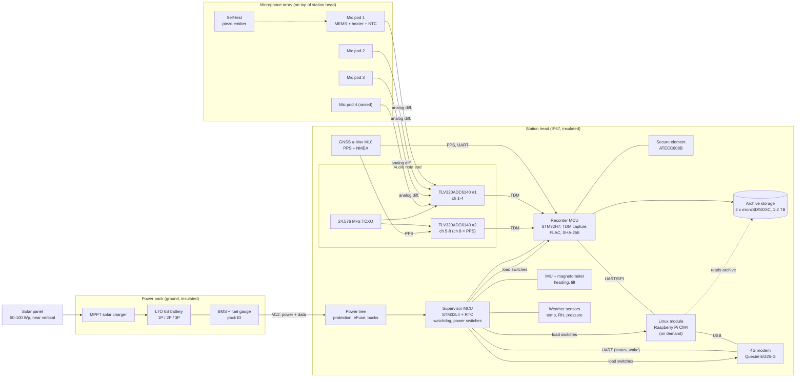

# Recording station hardware

Status: draft for review (step 1 of the plan). Owner: walto (hardware build), Claude (design support and firmware). Last updated 2026-11-02.

This document proposes the hardware for one recording station and for kits of 1 to N stations. It traces choices back to `docs/requirements.md` (`REQ-…`). Numbers marked *(est.)* are engineering estimates that the prototype must measure. Numbers marked *(verify)* come from datasheets or vendor pages and need checking against the exact part revision before the design is frozen.

---

## 1. Summary of the proposal

- **One station = three modules:** a *station head* (electronics box with the microphone array on top), a *power pack* (battery and solar charger in its own insulated box at ground level), and a *solar panel*. Every station is self-contained with its own 4G and GNSS, so a kit scales from 1 to 20+ stations by adding identical stations (REQ-O5). No hub is needed.
- **Microphones:** 4 analog MEMS microphones in a tetrahedral array (about 40 cm across), each in a heated, downward-facing, membrane-protected pod. The ADC side has 8 channels, so a 6-mic variant fits the same board.
- **Sampling and timing:** two TI TLV320ADC6140 ADCs share one TCXO clock (all channels sample-locked, REQ-T2). The GNSS PPS pulse is recorded as its own audio channel, so every file carries sample-exact UTC markers (REQ-T1) and stations line up to well under 1 ms (REQ-T2).
- **Compute, two-tier:** a low-power real-time recorder MCU (STM32H7 class) records, FLAC-encodes and hashes audio around the clock. A Linux module (Raspberry Pi CM4) wakes only for bulk uploads and remote sessions. This is what makes 28 days of continuous recording in winter possible (REQ-O1). A Linux-only design is simpler but needs about 2.5 times the battery.
- **Power:** lithium titanate (LTO) cells, which charge and discharge down to about -30 to -40 °C without heating. A 6S2P LTO pack (about 1.1 kWh) covers 28 days in midwinter with no solar at all. A 100 Wp panel mounted near vertical extends deployments from February to October indefinitely. A lighter LiFePO4 pack is offered for the warm season.
- **Integrity:** a secure element on the station signs the hash-chained manifests (REQ-I1, REQ-I2).
- **Rough cost** of one complete station at prototype quantities: **€1,500 to €2,600** *(est.)*, of which the power pack and storage are the largest swing items. Section 9 has the parts list.

The biggest open issue is **how much audio goes over 4G** (section 6.4). Uploading the full 4-channel archive in winter costs more energy and data than the station can afford, so this design treats the on-station disk as the archive of record and uploads signed manifests plus a reduced stream. This needs agreement with the Requirements, Edge and Cloud threads.

---

## 2. Block diagram



Text version for quick reading:

```
 [4-6 mic pods] --analog--> [2x ADC6140, TCXO] --TDM--> [Recorder MCU] --> [SD archive]
        ^                          ^ PPS on ch 8           |  SHA-256, signed by [Secure element]
 [self-test emitter]          [GNSS M10] --PPS/UART-------+
                                                           | UART
 [Supervisor MCU + RTC] --load switches--> [CM4 Linux] --USB--> [4G modem] --> cloud
   | sensors: battery V/I, temps, RH, IMU                           ^
   +--------------- status messages via modem AT/MQTT ---------------+
 [Power pack: LTO 6S + BMS + MPPT] <-- [solar panel]
```

---

## 3. Microphone array

### 3.1 Capsule choice

| Option | Self-noise / SNR | Cold rating | Unit-to-unit match | Notes |
|---|---|---|---|---|
| **Analog MEMS, Infineon IM73A135 (recommended)** | SNR about 73 dB(A) *(verify)* | -40 °C *(verify)* | tight (about ±1 dB) | Reflow-solderable, humidity-robust, high overload point (about 135 dB SPL). Analog output uses the ADC's low-noise inputs and avoids PDM clock lines in cables. |
| Digital PDM MEMS (e.g. Infineon IM69D130) | SNR about 69 dB(A) | -40 °C | tight | Simplest wiring, but the PDM clock on cables to the pods is an EMC risk and SNR is lower. Good for a cheaper "Lite" variant. |
| Analog electret (e.g. PUI AOM-5024L-HD) | SNR about 80 dB(A) | varies by part | wider spread, temperature drift | Lowest noise, so longer detection range, but needs per-unit calibration and is less consistent in cold and humidity. Worth testing side by side in the prototype. |

MEMS is the default because a trusted counting product benefits more from matched, stable, cold-rated channels than from the last few dB of noise floor. Electret capsules stay on the test list in case detection range is not good enough.

### 3.2 Array geometry

- **Tetrahedral, 4 mics:** three mics on horizontal arms 120° apart at a radius of about 20 cm, the fourth on a centre post about 25 cm higher. This gives azimuth and elevation with no front/back ambiguity, using time differences of arrival (for example GCC-PHAT) on broadband bird calls.
- Maximum time difference is about 1 ms across the array. With 48 kHz sampling and sub-sample interpolation, direction resolution of a few degrees is realistic *(est.)*. Spatial aliasing matters less for broadband calls with GCC-PHAT than for beamforming.
- A 6-mic variant (adding two mics at different heights) improves robustness when one pod fails or ices up. The ADC side supports it without board changes.
- The array head sits at 2 to 3 m height, which keeps it above deep snow in northern Finland (up to about 1 m) and away from ground reflections.

### 3.3 Mic pod (weather, snow and ice)

Each pod is a small sealed unit that plugs into the station head:

- Mic on a small round PCB, **sound port facing down**, under a drip cap so rain and snow cannot sit on it.
- **ePTFE acoustic membrane** (IP67 class) sealing the sound port, plus a replaceable open-cell hydrophobic foam windscreen. A fur cover is an accessory for windy sites.
- **Heater:** a thin-film or resistor heater of about 0.3 W per pod, with an NTC for the pod temperature. The supervisor turns it on only in icing conditions (air temperature between about -10 and +1 °C with RH above 95 %, or when the self-test shows a sensitivity drop). Rime ice and freezing fog are the main risks, not dry cold.
- Differential analog signal over about 1 m of shielded twisted pair with an **IP67 M8 4-pin connector** (signal +, signal -, mic bias, heater). Pods are field-swappable.
- The pod nose accepts a **½-inch calibrator adapter**, so a standard 94 dB / 1 kHz acoustic calibrator can be used before and after each deployment (REQ-A3).
- Housing in UV-stable ASA (3D printed for the prototype) or machined POM for production.

The membrane and windscreen change the frequency response, especially above 8 kHz. Every pod design must be measured in its final form against a reference mic, and the correction stored with the unit (REQ-A6).

### 3.4 Self-test and health

A small piezo emitter in the array hub plays a known chirp at scheduled times (for example daily at a quiet hour). Comparing each channel's response to its reference shows a dead channel, ice or water on a membrane, or sensitivity drift (REQ-A4). It also checks the inter-channel timing end to end (REQ-T2). The chirp is logged so the analysis can ignore it.

### 3.5 Audio spec proposal (for REQ-A6)

- Sample rate 48 kHz, 24 bit, fixed gain (REQ-A1, REQ-A2).
- Frequency response 100 Hz to 16 kHz, within ±3 dB after per-unit correction, from -30 to +35 °C.
- **The ADC's dynamic range enhancer (DRE) and any AGC must be disabled on the archive channels.** DRE is a form of automatic gain change, which REQ-A2 forbids.

---

## 4. Audio front end and timing

### 4.1 ADC

Two **TI TLV320ADC6140** ADCs give 8 channels on one TDM bus. Each has 4 analog inputs with programmable gain and mic bias, about 113 dB dynamic range without DRE, 9.2 mW per channel at 48 kHz, and is rated -40 to +125 °C ([TI product page](https://www.ti.com/product/TLV320ADC6140)). Both are clocked from one **24.576 MHz TCXO (±1 to 2 ppm, -40 °C rated)**, so all channels sample at the same instant. That meets REQ-T2's 0.1 ms inter-channel limit by a wide margin.

Channel plan: ch 1 to 6 for microphones (4 fitted by default), ch 7 spare (reference mic or line input for testing), **ch 8 for the GNSS PPS signal**.

### 4.2 GNSS time and position

- **u-blox MAX-M10S** (or similar M10 module): low power (tens of mW), PPS output with tens of ns accuracy *(verify)*, -40 °C rated. An active patch antenna sits on top of the head.
- **PPS recorded as audio:** the PPS pulse, attenuated, goes into ADC channel 8. Every second of every file has a marker on the exact sample where UTC seconds start. Software reads the UTC time of each marker from NMEA and can align files across stations to a sample (about 21 µs) with no reliance on operating-system timestamps. This meets REQ-T1 (under 10 ms to UTC) and REQ-T2 (under 1 ms between stations) by a large margin.
- The recorder MCU also captures PPS on a timer input as a backup and logs GNSS lock state. Without lock the TCXO drifts at most about 7 ms per hour *(est.)*, and that period is flagged as REQ-T1 requires.
- **Station position:** GNSS averaged over a deployment gives a few metres accuracy, which is fine for maps. Cross-station acoustic localisation needs station positions to roughly 0.5 m or better. Options are a dual-band module (u-blox F10 class) with long averaging, or measuring with a laser rangefinder at setup. This is an open question for the Requirements thread.

### 4.3 Orientation

Direction of arrival is only useful in map coordinates if the array's heading is known. A 9-axis IMU (accelerometer + magnetometer) logs heading and tilt each hour, and also detects if the station is knocked over or moved (tamper alert). The deployment guide will also ask the user to point a marked arm north, as a cross-check against magnetic errors near the battery.

---

## 5. Compute, storage and integrity

### 5.1 Architecture options

| | **A. Linux only** | **B. Recorder MCU + Linux on demand (recommended)** |
|---|---|---|
| Recording | CM4 records, encodes and hashes 24/7 | STM32H7 records, encodes and hashes 24/7 |
| Linux module | always on | off most of the time, wakes for uploads and remote sessions |
| Average power, winter *(est.)* | about 2.2 W | about 0.9 W |
| Battery for 28 days at -30 °C, no sun | 6S4P LTO, about 2.2 kWh, about 32 kg | 6S2P LTO, about 1.1 kWh, 14 to 16 kg |
| Firmware effort | lowest: all Linux, Python/C | higher: bare-metal or RTOS recorder firmware plus Linux side |
| Failure modes | SD/eMMC corruption on power loss, Linux crash stops recording | recorder is simple and keeps going if Linux or modem fails |
| Cold | CM4 rated -20 °C, so a pre-heater or an industrial module is needed | MCU rated -40 °C; CM4 only boots after a short pre-heat |

**Recommendation:** build **prototype v0 as architecture A** on development boards (fastest way to get real audio, measure power and develop the analysis pipeline), then build the **product as architecture B**. The recorder MCU is a small, testable piece of firmware. It is the only realistic way to meet REQ-O1 in winter with a pack one person can carry.

### 5.2 Parts

- **Recorder MCU:** STM32H7 class with SAI (TDM input), SDMMC, and ideally a hardware hash unit (for example STM32H733/H735, which include crypto/hash *(verify)*). It records the TDM stream, writes FLAC files (one file per 10 to 60 minutes), computes SHA-256 when each file closes (REQ-I1) and has the secure element sign the chained manifest (REQ-I2). FLAC encoding of 4 to 8 channels at 48 kHz in real time on an H7 must be confirmed on the bench.
- **Linux module:** Raspberry Pi CM4 (2 GB RAM, 8 GB eMMC, no Wi-Fi), rated -20 to +85 °C. It runs the uploader, the VPN for remote access, and any heavier jobs. If cold tests show problems, swap for an industrial -40 °C module (for example i.MX8M Mini SoMs from Toradex or Variscite) on the same carrier footprint concept.
- **Supervisor MCU:** STM32L4 class with an external low-power RTC (RV-3028, -40 °C). It is always on at a few mW. It runs the hardware watchdog, power-cycles the recorder, Linux module and modem, reads battery voltage/current/energy (TI INA228), temperatures (board, battery, pods, ambient) and humidity in the box, controls heaters, and sends the hourly status message (REQ-O3) through the modem's built-in TCP/MQTT stack without waking Linux.
- **Secure element:** Microchip ATECC608B (or NXP SE050). Holds the device private key used to sign manifests (REQ-I2) and to authenticate to the cloud.

### 5.3 Storage

Data volume for continuous recording at 48 kHz, 24 bit *(est.; outdoor audio with a 24-bit noise floor compresses to about 65 to 75 % in FLAC)*:

| Channels | Raw per day | FLAC per day | FLAC for 28 days |
|---|---|---|---|
| 4 | 50 GB | about 35 GB | about 1.0 TB |
| 6 | 75 GB | about 52 GB | about 1.5 TB |
| 1 (reduced stream) | 12 GB | about 8 GB | about 230 GB |

Proposal: **two industrial or high-endurance microSD/SDXC slots, 1 TB each**, written alternately, so one card failing loses at most half the files and the station keeps recording (REQ-O1: no silent data loss). Cards are swapped at each service visit. Availability of 1 TB cards rated to -25/-40 °C must be checked; the fallback is more slots with 512 GB cards. Architecture A would use an M.2 2242 NVMe SSD on the CM4's PCIe instead.

---

## 6. 4G and remote access

### 6.1 Modem

**Quectel EG25-G** (LTE Cat 4, global bands, falls back cleanly as Finland's 2G/3G networks close). Rated -35 to +75 °C operating and -40 to +85 °C extended, sleep about 1.8 mA and idle about 22 mA at 3.8 V ([Quectel spec](https://enpanel.quectel.com/wp-content/uploads/2021/03/Quectel_EG25-G_LTE_Standard_Specification_V1.6-1.pdf)). Cat 4 uplink (up to about 50 Mbps) matters because the station may need to move many GB. A Cat 1bis module is cheaper and lower power but too slow for audio uploads.

### 6.2 SIM and antennas

- Industrial SIM (MFF2 solder-down eSIM or industrial nano-SIM rated -40 °C), multi-operator if possible (Elisa, Telia, DNA coverage differs in remote areas).
- Two external LTE antennas (MIMO) on the mast with a surge arrester. A directional panel antenna is a kit accessory for weak-signal sites.

### 6.3 Remote access

- **Always available:** hourly status and alarms via the supervisor (REQ-O3), and remote configuration commands that the supervisor queues and logs (REQ-O4).
- **On demand:** the cloud sends a wake request (SMS or a message on the modem's open connection). The modem's ring-indicator line wakes the supervisor, which pre-heats if needed and boots the Linux module in about 30 to 60 s for a VPN session or a bulk upload.

### 6.4 Upload budget (open issue)

Uploading costs roughly 0.4 to 0.6 Wh per GB at good signal *(est.: modem about 2 W while sending at about 10 Mbps)*, and much more at weak signal. The full 4-channel archive is about 35 GB per day, which means about 3.2 Mbps sustained, about 16 Wh per day extra (doubling the winter battery), and about 1 TB of mobile data per station per month. In many remote Finnish sites the uplink cannot sustain that at all.

Proposed upload policy, configurable per project:

1. **Always:** signed manifests and hashes of every file, status, health and self-test results (kilobytes per hour). The cloud therefore knows exactly which files exist, and any later-ingested file can be verified against the chain (REQ-I2, REQ-I3).
2. **Default:** one reference channel in FLAC (about 8 GB per day) for cloud species ID, plus short multichannel clips on request.
3. **When power and coverage allow** (summer with solar, or a mains-powered site): the full multichannel archive.
4. **At service visit:** the SD cards are the archive of record and are ingested and verified against the signed manifests. The station only deletes files after the cloud confirms their hashes (REQ-I3), so nothing is lost by uploading less.

This keeps REQ-I1 to REQ-I4 intact, but it changes what "upload" means in REQ-I3 and REQ-O2. The Requirements, Edge and Cloud threads should agree on it.

---

## 7. Power

### 7.1 Why lithium titanate (LTO)

The station's own heat cannot keep a battery warm. A well-insulated box (50 mm XPS, about 0.5 m² surface) loses about 0.35 W per kelvin, so keeping a battery at 0 °C when it is -30 °C outside would need about 10 W continuously, ten times the station's whole budget *(est.)*. The battery chemistry itself must therefore work in the cold.

| Chemistry | Discharge at -30 °C | Charge below 0 °C | Energy density | Verdict |
|---|---|---|---|---|
| **LTO (lithium titanate)** | works, roughly 70 to 80 % of capacity at low current *(verify by test)* | yes, typically to -30 °C or lower | low, about 70 to 80 Wh/kg | **Recommended for year-round kits.** 10,000+ cycles, very safe. |
| LiFePO4 | poor; many cells spec -20 °C minimum | no; needs heating before charging | about 110 to 140 Wh/kg | **Warm-season pack** (April to October): lighter and cheaper. |
| Li-ion NMC | usable to about -20 °C | no | high | Not recommended: cold-charge and safety risks outdoors. |
| Lead-acid AGM | about 50 % | slow | about 30 Wh/kg | Too heavy (over 50 kg for the same usable energy). |
| Li-SOCl2 primary | excellent, to -55 °C | not rechargeable | very high | Only for an extreme-site option; expensive and creates waste. |

LTO cells such as the Yinlong 66160 (2.3 V, 40 Ah, about 92 Wh, about 1.1 to 1.3 kg per cell *(verify)*) are widely sold ([example vendor](https://hakadibattery.com/collections/lto-battery-cells-2-3v)). For a trusted product, cells should come from a traceable A-grade supplier (Yinlong/Gree, or Toshiba SCiB at higher cost), each pack tested for capacity before shipping.

A 6S LTO pack runs from about 10.8 to 16.2 V and a 4S LiFePO4 pack from about 10 to 14.6 V, so **one station input range of 9 to 17 V accepts both**. Each pack carries an ID chip, so the charger and the station know which chemistry and size are plugged in.

### 7.2 Power budget (architecture B, winter, continuous recording) *(est.)*

| Load | Average power |
|---|---|
| Recorder MCU (TDM capture, FLAC, SHA-256) | 0.25 W |
| SD card writes | 0.05 W |
| 2 ADCs, 4 mics, bias, TCXO | 0.08 W |
| GNSS (continuous for PPS) | 0.03 W |
| 4G modem: idle connected + reduced-stream upload (about 8 GB/day) | 0.20 W |
| Linux module, about 2 h/day at 1.5 W | 0.13 W |
| Supervisor, sensors, secure element | 0.02 W |
| Mic heaters (about 10 % of winter time, 4 pods) | 0.10 W |
| Converter losses (about 10 %) | 0.09 W |
| **Total** | **about 0.9 W (about 22 Wh/day)** |

Architecture A comes to about 2.2 W (53 Wh/day), mainly because the CM4 runs all the time (about 1.4 W) and needs an SSD.

### 7.3 Battery sizing

Usable winter energy = nominal × 0.75 (cold) × 0.9 (depth of discharge and ageing margin) *(est.)*.

| Pack (LTO 6S, 40 Ah cells) | Nominal | Usable at -30 °C | Weight (cells + box) | Days, arch. B (0.9 W) | Days, arch. A (2.2 W) |
|---|---|---|---|---|---|
| 6S1P (6 cells) | 552 Wh | about 370 Wh | about 9 kg | about 17 | about 7 |
| **6S2P (12 cells)** | 1,104 Wh | about 745 Wh | about 17 kg | **about 34** | about 14 |
| 6S3P (18 cells) | 1,656 Wh | about 1,120 Wh | about 25 kg | about 52 | about 21 |

So **architecture B with a 6S2P pack meets REQ-O1 (28 days, -30 °C) with no solar at all**, with about 20 % margin. The supervisor reports remaining runtime, and if the battery runs low it closes files cleanly, uploads a final manifest and stops with an alarm rather than corrupting data (REQ-O1: no silent loss).

### 7.4 Solar

Rough yields for one 100 Wp panel facing south at about 70 to 90° tilt *(est.; verify per site with [PVGIS](https://re.jrc.ec.europa.eu/pvg_tools/en/), which this environment could not reach)*:

- **December, southern Finland:** about 10 to 40 Wh per day on average, with many days near zero. **Lapland in December to mid-January (polar night):** essentially zero.
- **February to March:** strong, often 150 to 300 Wh per day, helped by snow reflection on a near-vertical panel.
- **April to September:** far more than the station needs.

Design rule: **size the battery as if there is no sun from November to January.** Treat solar as a bonus then, and as the main source the rest of the year, when a 6S1P or LiFePO4 pack plus a 50 to 100 Wp panel runs indefinitely. A near-vertical panel sheds snow and catches the low winter sun.

### 7.5 Charger, BMS and power tree

- **Prototype:** Victron SmartSolar MPPT 75/10 with user-defined voltages for LTO (operating range down to -30 °C *(verify)*, which is at the edge, so it goes inside the insulated pack box), and a commercial 6S LTO BMS with balancing.
- **Product:** an integrated power-pack PCB with an MPPT buck-boost controller rated -40 °C (for example ADI LT8491), a 6S protection and balancing IC that supports LTO thresholds (for example TI BQ76930 class *(verify cell UV range down to 1.8 V)*), a fuel gauge and the pack ID chip.
- **Station power tree:** reverse-polarity ideal diode, TVS and fuse, eFuse, then a high-efficiency 5 V buck for the Linux module, a dedicated 3.8 V buck for the modem (2 A peaks), a 3.3 V buck for digital, and low-noise LDOs for the ADC analog rails. All parts rated -40 °C. Each load sits behind a supervisor-controlled load switch.
- **Pack to station cable:** IP67 M12 connector with power plus a data line (pack ID, state of charge, pack temperature).

---

## 8. Enclosure, mounting and environment

- **Station head:** IP67 polycarbonate box (about 250 × 200 × 120 mm, Fibox or Spelsberg class), lined with 20 to 30 mm closed-cell foam to slow temperature swings, a Gore-type pressure-equalising vent and a desiccant pack against condensation. PCBs are conformal-coated. All cables enter through IP67 M8/M12 bulkhead connectors, so the user never opens the box in the field.
- **Array frame:** aluminium or carbon tube arms on a hub that bolts onto the box lid, folding for transport.
- **Weather sensors (REQ-A5):** Sensirion SHT45 (temperature, RH) in a small radiation shield and a Bosch BMP390 (pressure). Wind and rain are estimated from the audio first; a cheap rain sensor is optional.
- **Mounting:** tree strap or a 2 to 3 m pole/tripod with guy lines. The power pack sits on the ground, connected by a 3 to 5 m cable. A cable lock and the IMU tamper alarm deter theft.
- **Protection:** surge arresters on antenna lines, TVS on all external connectors.
- **Radio approval:** using a pre-certified modem module and GNSS receiver keeps CE/RED testing simpler. EMC and RED testing of the full station are still needed before sale (Product thread).

---

## 9. Parts list (one station, prototype quantities)

Prices in euros, excluding VAT, at 1 to 5 units *(est.)*. Small-series prices (50+) are expected to be roughly 40 to 55 % of these. Exact suppliers and part numbers go into a BOM spreadsheet in step 3.

### 9.1 Station head (architecture B)

| # | Item | Example part | Qty | Est. cost |
|---|---|---|---|---|
| 1 | MEMS microphone | Infineon IM73A135V01 | 4 (+2 spare) | €15 to 25 |
| 2 | Mic pod parts: PCB, housing, ePTFE membrane, foam, heater, NTC, M8 cable | custom | 4 | €80 to 140 |
| 3 | Audio ADC | TI TLV320ADC6140 | 2 | €10 to 16 |
| 4 | TCXO 24.576 MHz, ±2 ppm, -40 °C | various | 1 | €3 to 6 |
| 5 | Recorder MCU | STM32H733/H735 | 1 | €10 to 15 |
| 6 | Supervisor MCU + RTC + power monitor | STM32L4, RV-3028, INA228 | 1 set | €12 to 18 |
| 7 | Secure element | Microchip ATECC608B | 1 | €1 to 2 |
| 8 | Archive storage, 1 TB high-endurance/industrial | microSDXC | 2 | €150 to 400 |
| 9 | Linux module | Raspberry Pi CM4 2 GB / 8 GB eMMC, no wireless | 1 | €45 to 65 |
| 10 | 4G modem | Quectel EG25-G | 1 | €40 to 60 |
| 11 | Industrial SIM / eSIM | operator | 1 | (opex) |
| 12 | GNSS module + active antenna | u-blox MAX-M10S | 1 | €25 to 40 |
| 13 | IMU + magnetometer | ST or Bosch 9-axis | 1 | €6 to 10 |
| 14 | Weather sensors + radiation shield | SHT45, BMP390 | 1 set | €20 to 30 |
| 15 | Self-test piezo + driver | various | 1 | €5 to 10 |
| 16 | Carrier PCB, fab and assembly | custom, 4 to 6 layers | 1 | €150 to 300 |
| 17 | Power tree components | bucks, eFuse, TVS, ideal diode | 1 set | €20 to 35 |
| 18 | Enclosure, foam, vent, desiccant | Fibox/Spelsberg IP67 | 1 | €50 to 80 |
| 19 | IP67 bulkhead connectors and cables | M8/M12 | 7 | €50 to 80 |
| 20 | Array frame and hub | aluminium/carbon, printed hub | 1 | €30 to 60 |
| 21 | LTE antennas (2) + surge arrester | outdoor omni | 1 set | €40 to 80 |
| 22 | Mounting kit and cable lock | strap, pole clamp | 1 | €40 to 70 |
| 23 | Fasteners, coating, misc. | | | €20 to 30 |
| | **Station head total** | | | **about €820 to 1,580** |

### 9.2 Power pack and solar

| # | Item | Example part | Qty | Est. cost |
|---|---|---|---|---|
| 24 | LTO cell 2.3 V 40 Ah, A-grade | Yinlong 66160 | 12 (6S2P) | €300 to 540 |
| 25 | 6S LTO BMS with balancing | commercial for prototype | 1 | €40 to 90 |
| 26 | MPPT charger | Victron SmartSolar 75/10 | 1 | €70 to 90 |
| 27 | Pack ID / fuel gauge board | custom | 1 | €15 to 25 |
| 28 | Insulated IP65 pack box, connectors | | 1 | €60 to 100 |
| 29 | Solar panel 100 Wp mono + near-vertical bracket + cable | | 1 | €110 to 180 |
| | **Power pack (6S2P) + solar total** | | | **about €600 to 1,030** |

A 6S1P pack saves about €150 to 270 and 8 kg. A warm-season LiFePO4 pack (12.8 V, 50 Ah) costs about €150 to 250.

### 9.3 Per kit (shared across stations)

| Item | Est. cost |
|---|---|
| Acoustic calibrator (94 dB, 1 kHz, class 1 or 2) with ½-inch pod adapter (REQ-A3) | €300 to 700 |
| Transport cases, spare pods, spare windscreens, tools | €150 to 300 |

**One complete station (head + 6S2P pack + panel): about €1,420 to 2,610 at prototype quantities** *(est.)*. Architecture A saves the recorder MCU (about €15) but needs an SSD and a 6S4P pack (about €300 to 550 more and about 15 kg heavier than 6S2P).

---

## 10. Trade-offs at a glance

| Decision | Chosen | Alternative | Why |
|---|---|---|---|
| Mic type | analog MEMS | electret, digital MEMS | matched, cold-rated, robust; electret tested in prototype for range |
| Mics per station | 4 (6 optional) | 2, 8 | 4 is the minimum for 3D direction without ambiguity |
| Timing | PPS recorded as an audio channel | GPS-disciplined oscillator, OS timestamps | sample-exact, simple, verifiable in the data itself |
| Compute | recorder MCU + Linux on demand | Linux only | 2.5 times less energy, recording survives Linux or modem faults |
| Archive | on-station SD, manifests uploaded | full upload over 4G | 4G energy and data cost; integrity preserved by signed manifests |
| Battery | LTO | LiFePO4, Li-SOCl2 | charges and discharges at -30 °C without heating |
| Layout | separate power pack at ground | all in one box | heavy pack on the ground, light head on the mast, pack sizes swappable |
| Kit scaling | identical autonomous stations | hub with mesh radio | each station works alone, so 1 to 20+ stations is just a count |

---

## 11. Risks and how the prototype tests them

1. **Power is higher than estimated.** Measure each block on the bench (INA228 logging) in v0. The design has margin, and the upload policy is the main lever.
2. **LTO capacity at -30 °C.** Discharge-test a 6S1P pack in a freezer and outdoors in January at the real station current.
3. **Icing of mic membranes.** Freezer and outdoor tests with mist spray; check that the self-test detects it and the heater clears it.
4. **Membrane and windscreen frequency response** above 10 kHz. Measure against a reference mic.
5. **FLAC encoding throughput on the MCU.** Bench test early. Fallback: store uncompressed on larger cards, or a faster MCU (i.MX RT class).
6. **CM4 booting at -30 °C.** Cold-boot tests with and without the pre-heater. Fallback: industrial SoM.
7. **4G coverage at remote sites.** Log signal quality in the field pilot; directional antenna accessory.

A home freezer only reaches about -18 to -24 °C, so the -30 °C tests need either a rented climate chamber or outdoor tests in January.

---

## 12. Prototype path (input for step 3)

- **v0, bench (architecture A):** Raspberry Pi CM4 on the official IO board, TLV320ADC6140 evaluation board, 4 MEMS mic breakouts, GNSS breakout with PPS wired to ADC channel 8, EG25-G USB adapter, lab supply with power logging. Goal: real 4-channel recordings with PPS markers, power measurements, data for the Edge and Cloud threads.
- **v1, field (architecture B):** custom carrier PCB with recorder MCU, supervisor, ADCs and power tree. Prototype mic pods. 6S1P LTO pack with commercial BMS and Victron MPPT. Goal: 2-week outdoor test, then a 4-week January test.
- **v2, pilot kit:** 3 to 5 stations with production-intent pods, integrated power pack PCB and enclosures, for the field pilot in step 4.

---

## 13. Open questions

For walto:

1. Is a separate ground-level power pack (about 17 kg for the winter pack) acceptable, or is there a weight limit per station that a user should carry?
2. Should the kit work in Lapland during the polar night (December to mid-January), or is southern and central Finland enough for winter?
3. What tools do you have for building: PCB design (KiCad?), reflow or hot-air, 3D printer, any access to a cold chamber?
4. Is a 4-mic array per station the right base, with a 1 to 2 mic "Lite" variant for hobbyists left to the Product thread?

For other threads:

- **Requirements / Edge / Cloud:** agree the upload policy in section 6.4 (on-station archive of record vs full upload), since it drives battery size and data cost.
- **Requirements:** how accurately station positions must be known for cross-station localisation (section 4.2).
- **Product:** CE/RED and EMC testing plan; whether to sell LiFePO4 summer packs alongside LTO.

## Sources

- [TI TLV320ADC6140 product page](https://www.ti.com/product/TLV320ADC6140): channels, dynamic range, power, temperature range.
- [Quectel EG25-G LTE Standard Specification V1.6](https://enpanel.quectel.com/wp-content/uploads/2021/03/Quectel_EG25-G_LTE_Standard_Specification_V1.6-1.pdf): sleep and idle current, temperature ranges, supply voltage.
- [LTO 2.3 V cell listings (example vendor)](https://hakadibattery.com/collections/lto-battery-cells-2-3v): cell formats and availability.
- [PVGIS](https://re.jrc.ec.europa.eu/pvg_tools/en/): use for per-site solar yield; the estimates above were not computed with it.
